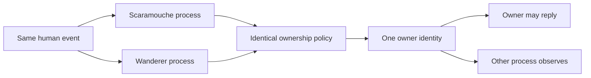

# Design case study: one human message, one reply owner

## Problem and scope

Scaramouche and Wanderer can share a Discord channel. Both receive a human message, but a person addressing one character should not cause two competing replies. Follow-ups and references to another bot also make name-only matching ambiguous.

This is a design case study with an executable reproduction. It is not a measured claim that every deployed routing path is resolved. Historical development involved multiple local and deployed versions; this document does not equate them.

## Design decision

Separate target resolution from ownership. The resolver uses explicit mentions and reply references to identify an intended target. The owner function receives those resolved values and applies a small priority policy:

1. Channel blocks win over everything.
2. A solo bot can respond without waiting for an absent partner.
3. A direct address overrides a reply target.
4. A reply target wins over ambient selection.
5. An ambient message maps to one stable owner from its event ID.

Both processes compute the same answer. A stable digest avoids a shared database lock for this fixture and avoids Python's process-randomized built-in hash. The public [routing task](../tasks/routing/TASK.md) tests the boundary explicitly.

## Tests and alternatives

Acceptance checks exercise both direct targets, both reply targets, solo operation, blocked direct calls, and ambient IDs across fresh Python processes. They require more than a constant return value. The fixture imposes no particular digest algorithm.

A central queue or distributed lease could coordinate generation and playback more strongly, but would add a stateful service and failure modes. A deterministic owner is a useful smaller boundary for independent processes.

## Limitations

Stable ownership does not guarantee exactly-once delivery. Duplicate events still need deduplication, transient failures may need retry policy, and an offline chosen owner may require explicit failover. Natural-language pronoun resolution and two-person overlapping voice speech require separate tests. Different model transcripts can disagree even when both processes use the same policy.

## Engineering lesson

Specify who owns an event before producing personality-driven output. A small deterministic contract makes concurrency behavior reproducible, while leaving language interpretation and playback coordination visible as separate responsibilities.
